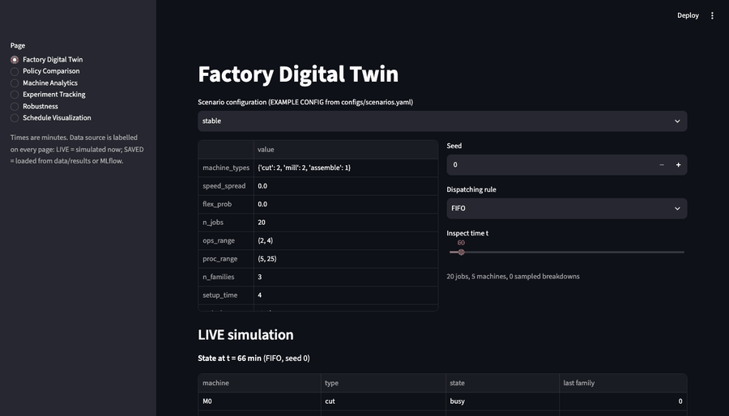
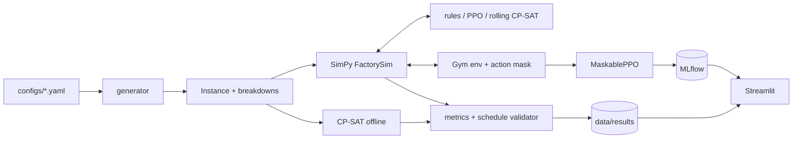

# ForgeRL: Smart Factory RL Scheduler

Job-shop scheduling digital twin (SimPy) that benchmarks a PPO agent against six dispatching rules and OR-Tools CP-SAT under machine breakdowns and dynamic arrivals. Python, Gymnasium, Stable-Baselines3, MLflow, Streamlit.

[](https://github.com/nithya-prakash/ForgeRL/actions/workflows/ci.yaml)




*Shows: the six dashboard pages, real captures of the running app reading saved results (static frames, no live interaction). Doesn't show: training, or the Docker/MLflow containers.*

## Results

Question: does PPO beat classic scheduling rules? **Not in these experiments.**

| Metric | Result | Data | Reproduce |
|---|---|---|---|
| Mean weighted tardiness, ATC (best rule on validation seeds) vs PPO | 3227 vs 4250 min (PPO 32% worse; pooled paired diff +1023, 95% CI [747, 1299]) | 100 held-out test instances (5 scenarios x 20 seeds), identical jobs and failures per policy | `factory-scheduler compare --model models/ppo_1m_tardy_best.zip --n-seeds 20` |
| PPO minus ATC, per scenario (paired) | +26% to +56%; Holm-adjusted Wilcoxon p 1e-5 to 1.9e-3 | n = 20 seeds per scenario | same command; `data/results/compare_ppo_vs_ref.csv` |
| PPO rank among 7 online policies | 3rd (ATC, CR ahead) | same 100 instances | same command |
| Offline CP-SAT, proven optimal | 100 of 100 solves OPTIMAL; makespan 152.9 vs 159.3 (best rule); weighted tardiness 26.1 vs 42.9 | 10-job static instances, 50 per objective | `factory-scheduler cpsat --n-seeds 10` |
| Rolling CP-SAT (0.1 deterministic-second budget per solve) | 4282 vs ATC 3066 (worse; 6th of 8, ahead of only LSL and FIFO); ~380 ms per decision; two runs bit-identical. An older wall-clock 0.1 s run scored 4810 | 8 seeds x 5 scenarios | `factory-scheduler compare --model models/ppo_1m_tardy_best.zip --rolling --rolling-det-time 0.1 --n-seeds 8 --name compare_rolling_det_a` |
| Clone of ATC in the PPO network, then PPO fine-tuned from it | Test: clone 3408 (+5.6% vs ATC, p 2e-5), fine-tuned 3612 (+11.9%). Validation: 4084 and 4517 vs ATC 3884 | test 100 instances / validation 50 instances; 3 seeds | `scripts/rl_experiment_bc.py SEED`, `scripts/rl_experiment_bc_test.py` |
| PPO vs ATC in sweeps | PPO worse than ATC at all 12 levels (+29% to +106%) | load, breakdown, arrival sweeps, 4 levels x 10 test seeds | `factory-scheduler sweep load --model models/ppo_1m_tardy_best.zip` (also `breakdown`, `arrival`) |
| Tests | 47 pass | `tests/` | `make test` |

Weighted tardiness = sum of priority x max(0, completion - due) in minutes, lower is better.

## Honest reading
The PPO result is one training recipe (1M steps, one seed per reward setting, no hyperparameter search), so it does not show that RL cannot work here. The reference rule (ATC) was chosen on validation seeds, per-scenario p-values are Holm-corrected, and the pooled row treats instances as independent pairs. CP-SAT numbers use tiny static instances where it sees future arrivals, so they are a reference, not an online comparison. The factory is synthetic and unvalidated against a real plant.

## Quickstart
```bash
make install     # needs Python >= 3.12 and uv; uv sync, also clears a macOS .pth quirk
make test
make dashboard   # http://localhost:8501, reads data/results and mlflow.db (experiment page empty until you train)
```
| Variable | Purpose | Default |
|---|---|---|
| `MLFLOW_TRACKING_URI` | MLflow store | `sqlite:///mlflow.db` in the repo root |
| `FACTORY_RESULTS_DIR` | where CLI writes and dashboard reads results | `data/results` |

## Architecture

Stack: SimPy, Gymnasium, Stable-Baselines3 + sb3-contrib, OR-Tools CP-SAT, MLflow, Streamlit/Plotly, pytest, Hypothesis, Ruff, mypy, uv, Docker.

## Usage
```bash
uv run factory-scheduler benchmark --n-seeds 20                  # six rules on the test seeds
uv run factory-scheduler train --smoke                           # 1k-step PPO smoke run (omit --smoke for configs/ppo.yaml)
uv run factory-scheduler sweep load --n-seeds 10                 # also: breakdown, arrival
```
Why PPO lost, with evidence and the stopping rule: [docs/rl_failure_analysis.md](docs/rl_failure_analysis.md).

## Limitations
- CI covers lock check, Ruff, mypy, the 47 tests and a CLI smoke run; it does not run PPO training or the benchmark.
- Not measured: more than one from-scratch PPO seed per reward setting; training reproducibility on another machine.
- Not implemented: idling or lookahead actions (dispatching is non-delay), setups and breakdowns inside CP-SAT, validation against real factory data.
- The PPO checkpoint is shipped in `models/` (checksum in `models/SHA256SUMS`); retraining is seeded but not guaranteed bit-identical across machines. The MLflow DB is not committed.
- `make demo` and the 1M-step training were not re-run during release prep.

## More
Full tables, protocol, sweeps and verification log: [docs/details.md](docs/details.md), [IMPLEMENTATION_STATUS.md](IMPLEMENTATION_STATUS.md). Layout: `src/factory_scheduler/` (simulation, policies, environment, rl, optimization, evaluation, dashboard), `configs/`, `tests/`, `scripts/`, `data/results/`, `docs/`. Checks: `make lint typecheck test`. Docker: `make docker`. License: MIT, see [LICENSE](LICENSE).
