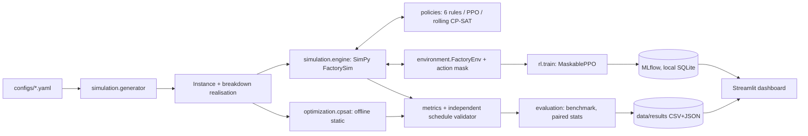
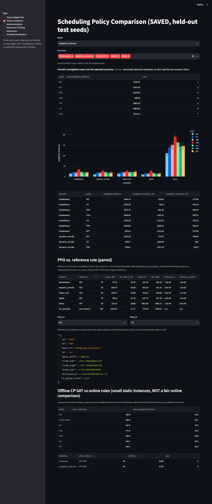
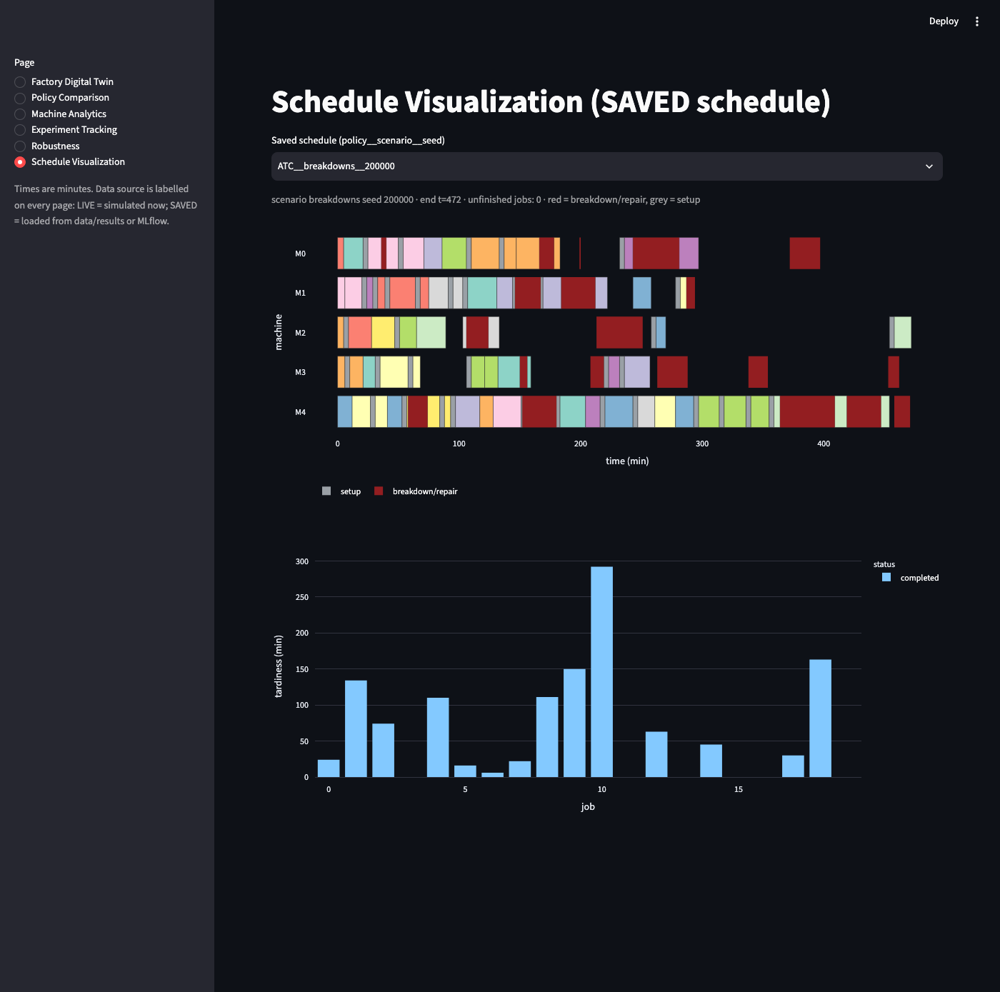
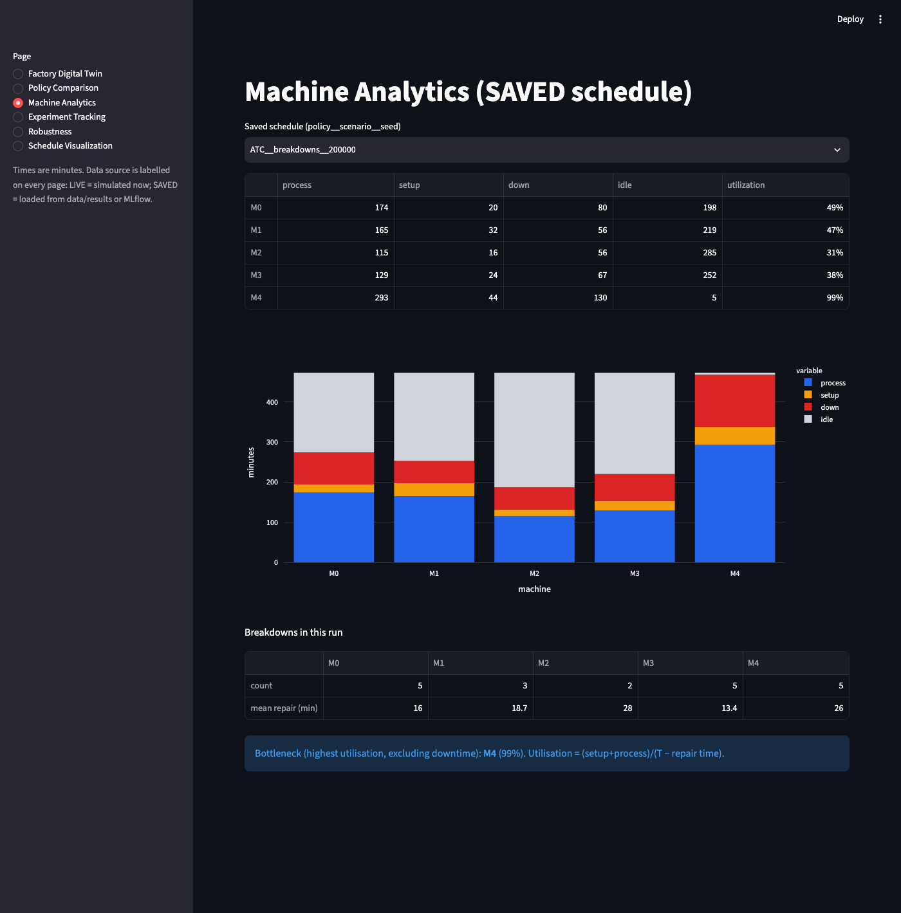
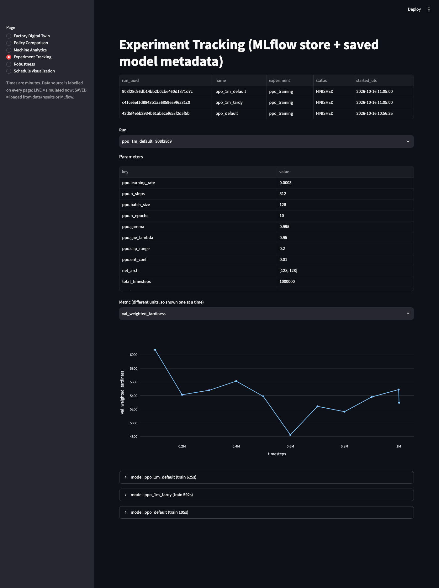

# Details (full results, protocol, reproduction)

The short README is [../README.md](../README.md). This file keeps the long-form material.

**Motivation:** scheduling under breakdowns and late-arriving jobs is NP-hard, rules are fast but myopic, CP-SAT is strong but needs a static problem, and RL promises fast adaptive policies. This repo tests that promise carefully rather than assuming it.

**Research question:** can a PPO agent produce competitive job-shop schedules compared with dispatching rules and OR-Tools CP-SAT, particularly with machine breakdowns, dynamic arrivals and changing load?

**Short answer from these experiments: no.** A PPO agent (1M steps, CPU) ranked 3rd of 7 online policies and was significantly worse than the ATC dispatching rule in every scenario. The project's value is the validated simulator, the fair evaluation harness and the negative result with a diagnosis ([docs/rl_failure_analysis.md](rl_failure_analysis.md)).

The simulator is a **simplified synthetic digital twin**. It has not been validated against a real factory, and no industrial performance is claimed.

## What is in the repo

Stack: Python 3.12, SimPy, Gymnasium, Stable-Baselines3 + sb3-contrib (MaskablePPO), OR-Tools CP-SAT, MLflow, Streamlit/Plotly, pytest + Hypothesis, Ruff, mypy, uv.

## Simulation model (details: `docs/simulation_model.md`)
Integer-minute job shop: machine types, multi-operation routings, per-machine processing times (eligibility), product families with sequence-dependent setups, release times (static or Poisson), due dates and priority weights, pre-sampled exponential breakdowns (preempt-resume). Breakdowns and arrivals are fixed per (scenario, seed), so **every policy faces identical jobs and failures**. Policies only see released jobs; dispatching is non-delay. Five scenarios in `configs/scenarios.yaml`: `stable`, `breakdowns`, `dynamic_arrivals`, `hetero_full`, `stress`. Every produced schedule is checked by an independent validator (overlaps, downtime, eligibility, precedence, release, processing totals).

## Policies
* Rules: FIFO, SPT, EDD, Critical Ratio, least slack, **ATC** (priority-weighted apparent tardiness cost; uses remaining work, queue congestion and machine speed). Same candidate list and constraints for all.
* **PPO**: MaskablePPO, 24-slot masked action space, reward = exact negative weighted flow + tardiness (`docs/rl_design.md`). Trained on train seeds, checkpoint chosen on validation seeds.
* **CP-SAT**: *offline* static optimum (all jobs and future releases known; no breakdowns or setups) and an *online* rolling-horizon policy (re-solve at each decision, released jobs only) (`docs/optimization.md`).

## Evaluation protocol (`docs/evaluation_protocol.md`)
Seeds: train 0-199, validation 100000+, test 200000+. Reported comparison: 5 scenarios x 20 test seeds = 100 instances, all policies on identical instances. Weighted tardiness = sum over jobs of priority x max(0, completion - due); unfinished jobs are charged to the horizon (none occurred in these runs). Per-scenario paired comparison: mean difference, t-interval, Wilcoxon signed-rank, Cohen's dz. The reference rule per scenario is chosen on **validation** seeds (ATC in all five), per-scenario p-values are Holm-adjusted across the five scenarios, and a pooled row over all 100 (scenario, seed) pairs treats instances as independent pairs. The earlier version of this analysis chose the reference on the test data (same answer, ATC); that file is kept as `data/results/compare_ppo_vs_best.csv`, the current one is `compare_ppo_vs_ref.csv`.

**Metric definitions** (T = end of run; full list in `docs/simulation_model.md`): *weighted tardiness* = sum over jobs of priority x max(0, completion - due), unfinished jobs charged to the horizon; *flow time* = completion - release; *makespan* = last completion; *on-time %* counts unfinished jobs as late; *utilisation* = (setup + processing minutes) / (T - repair minutes), i.e. it excludes downtime; *decision latency* = wall time of one dispatch decision.

## Results (reproduced; `data/results/compare.csv`)
Mean weighted tardiness, minutes (lower is better):

| policy | breakdowns | dynamic | hetero | stable | stress | mean |
|---|---|---|---|---|---|---|
| **ATC** | 1454 | 1082 | 1458 | 1017 | 11122 | **3227** |
| CR | 2020 | 1793 | 1953 | 1503 | 13889 | 4232 |
| PPO | 1826 | 1691 | 2098 | 1300 | 14335 | 4250 |
| EDD | 1873 | 1835 | 1996 | 1368 | 15162 | 4447 |
| SPT | 2026 | 1884 | 2351 | 1479 | 14668 | 4482 |
| LSL | 2196 | 2084 | 2081 | 1626 | 16316 | 4861 |
| FIFO | 3441 | 2808 | 2698 | 2697 | 19111 | 6151 |

PPO minus ATC, paired over 20 seeds (95% t-interval; PPO is worse by 26-56% per scenario):

| scenario | diff | % vs ATC | 95% CI | Wilcoxon p | Holm-adjusted p |
|---|---|---|---|---|---|
| stable | +282 | +27.8% | [148, 417] | 4.0e-4 | 1.6e-3 |
| breakdowns | +372 | +25.6% | [161, 582] | 1.9e-3 | 1.9e-3 |
| dynamic_arrivals | +610 | +56.4% | [302, 917] | 3.9e-4 | 1.6e-3 |
| hetero_full | +640 | +43.9% | [353, 927] | 8.4e-4 | 1.7e-3 |
| stress | +3212 | +28.9% | [2461, 3964] | 1.9e-6 | 1.0e-5 |
| pooled (n = 100) | +1023 | +31.7% | [747, 1299] | n/a (not tested) | n/a |

PPO beats ATC on only 0-15% of individual instances. PPO ranks behind CR in `hetero_full` and `stress`. Decision latency: PPO ~0.3 ms, rules <0.05 ms.

**Why ATC won here (evidence in `rl_failure_analysis.md`, still hypotheses):** cloning ATC into the same network/observation gets within +5% of ATC on validation and +5.6% on the test set (3 seeds, p 2e-5), so the observation can represent a strong rule; PPO fine-tuning from that clone gets worse (+16% on validation, +11.9% on test, all three seeds), and PPO from scratch is +28% on the validation set and +31.7% on test. (The test numbers are reporting only; nothing was selected on them.) That points to RL optimisation (exploration/credit assignment under this reward), not the observation or action-slot truncation. Not tested: critic pre-training, idling/lookahead actions, longer runs with many seeds.

**CP-SAT (offline, 10-job static variants, no breakdowns/setups, 10 seeds x 5 scenarios x 2 objectives = 100 solves):** all 100 solves returned status OPTIMAL (gap 0, max 4.7 s). Mean makespan 152.9 vs 159.3 for the best online rule (FIFO); mean weighted tardiness 26.1 vs 42.9 (ATC). CP-SAT sees future arrivals and can idle machines, so this is a reference bound, **not** a fair comparison with online policies, and it says nothing about larger instances. **Rolling CP-SAT** (full dynamics, 8 seeds, models neither setups nor breakdowns): with a deterministic-time budget of 0.1 per solve (`compare_rolling_det_a/b.csv`, two runs bit-identical) it scored 4282 vs ATC 3066, 6th of 8 policies (only LSL and FIFO are worse), ~380 ms/decision. The older wall-clock-limited run (`compare_rolling.csv`, 0.1 s/solve, not reproducible bit for bit) scored 4810 at ~68 ms/decision. Larger budgets were not tried.

**Sweeps** (`data/results/sweep_*.csv`, 10 test seeds/level): ATC leads FIFO/EDD/SPT at every tested load, breakdown rate and arrival rate. PPO is now included in all three sweeps (the rule rows were re-run and match the earlier files exactly): it is worse than ATC at all 12 levels (+29% to +106%) and beats the best of EDD/SPT/FIFO at only 8 of 12 levels.

Two earlier artifacts are preserved: `data/results/heuristics.csv` (rules only, identical to the rule rows in `compare.csv`) and `data/results/repro_compare.csv` (re-run of the comparison during the audit: all deterministic columns identical).

## Dashboard
`make dashboard` (reads only saved results, MLflow and clearly labelled live simulations). Real screenshots from the running app (`scripts/capture_screenshots.py`):

| | |
|---|---|
|  |  |
|  |  |

Also `01_digital_twin.png`, `05_robustness.png`, and a phone-width capture `06_schedule_gantt_w400.png`.

## Install and quick start
```bash
# requires Python >= 3.12 and uv (https://docs.astral.sh/uv/)
git clone https://github.com/nithya-prakash/ForgeRL.git && cd ForgeRL
make install                 # uv sync + clears macOS hidden flag on .pth files (see below)
make test                    # 47 tests
uv run factory-scheduler benchmark --n-seeds 20            # rules
uv run factory-scheduler cpsat --n-seeds 10                # offline CP-SAT vs rules
uv run factory-scheduler train                             # PPO (configs/ppo.yaml; --smoke = 1k steps)
uv run factory-scheduler compare --model models/ppo_1m_tardy_best.zip [--rolling --rolling-det-time 0.1]
uv run factory-scheduler sweep load|breakdown|arrival [--model models/ppo_1m_tardy_best.zip]
make mlflow ; make dashboard
```
macOS note: in some environments the venv's editable-install `.pth` file gets the hidden flag and `import factory_scheduler` fails; `make install` clears it, or run with `PYTHONPATH=src`. On Linux, `uv.lock` resolves the CPU-only torch wheel.

## Reproduce
The reported PPO checkpoint is committed as `models/ppo_1m_tardy_best.zip` (checksum and training details in `models/README.md`), so the comparison and sweeps reproduce without retraining: re-running `compare` and all three `sweep` commands with it matched the saved results exactly. Retraining (`python scripts/train_run.py ppo_1m_tardy 1000000 0.2 2.0`) is seeded but not guaranteed bit-identical across machines, and was not repeated. The MLflow DB is not committed. The diagnostic experiment: `scripts/rl_diagnostics.py`, `scripts/rl_experiment_bc.py SEED`, `scripts/summarize_bc_experiment.py`, `scripts/rl_experiment_bc_test.py`.

## Verification status (see `IMPLEMENTATION_STATUS.md` for commands)
Verified: 47 tests (latest run; 43 at the clean-checkout run), Ruff, mypy, clean-checkout `uv sync --frozen` + tests + CLI, dashboard inspected visually, results reproduced. Docker image builds (2.3 GB, CPU torch), container healthy, `docker compose up` brings up both the dashboard (:8501) and the MLflow UI (:5000), each answering its health endpoint (`make docker` creates the needed `mlflow.db` first). GitHub Actions: first run on `main` passed (lock check, sync with CPU torch, Ruff, mypy, pytest, CLI smoke). Not verified: `make demo`.

## Limitations
Synthetic, unvalidated twin; exponential failures; non-delay dispatching only (the action space cannot idle on purpose); one PPO training seed per reward setting and no hyperparameter search; ATC is untuned yet strong; offline CP-SAT limited to 10-job instances; stress runs never hit the horizon, so truncation behaviour is only unit-tested.

## Future work
Critic pre-training and residual-on-ATC policies, idling/lookahead actions, scenarios where simple rules are demonstrably weak, multi-seed PPO with a fixed compute budget, and a longer rolling-horizon CP-SAT with setups and breakdowns modelled.

## License
MIT, see [LICENSE](../LICENSE).
